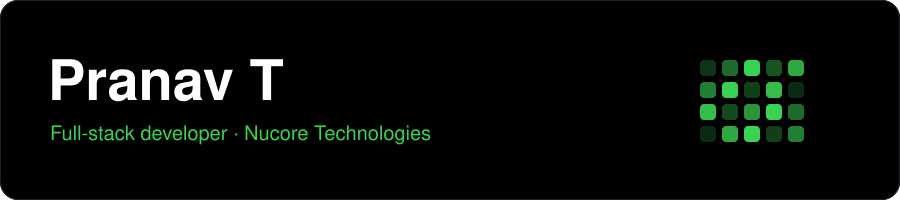

I build web apps with Python (FastAPI, Django) and React/TypeScript, and spend some time on automation and DSA.

    
  

**Projects**

- [Signify](https://github.com/Pranav-Conova/Signify): control presentation slides with hand gestures
- [AI-Powered-ChatApp](https://github.com/Pranav-Conova/AI-Powered-ChatApp): real-time multiplayer chat with AI-picked topics
- [Dating Itinerary Builder](https://github.com/Pranav-Conova/dating-itinerary-builder-backend): FastAPI + React app for planning dates
- [n8n clone](https://github.com/Pranav-Conova/n8n_clone_backend): a small workflow automation engine

<picture>
  <source media="(prefers-color-scheme: dark)" srcset="https://raw.githubusercontent.com/Pranav-Conova/Pranav-Conova/output/github-snake-dark.svg" />
  
</picture>

Reach me at pranav.t@nucoreindia.com
